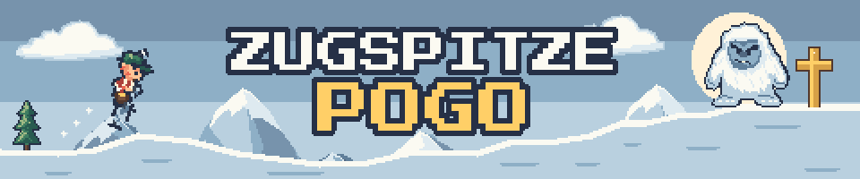
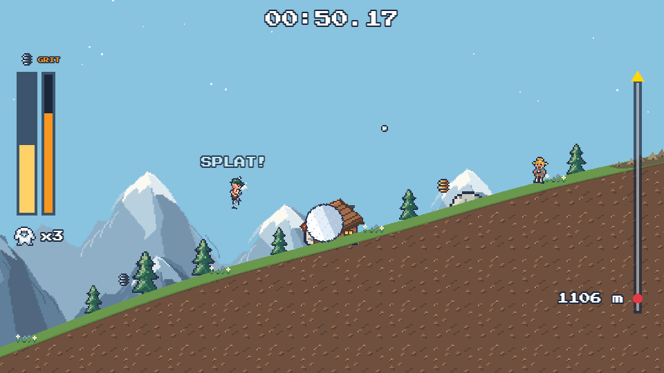
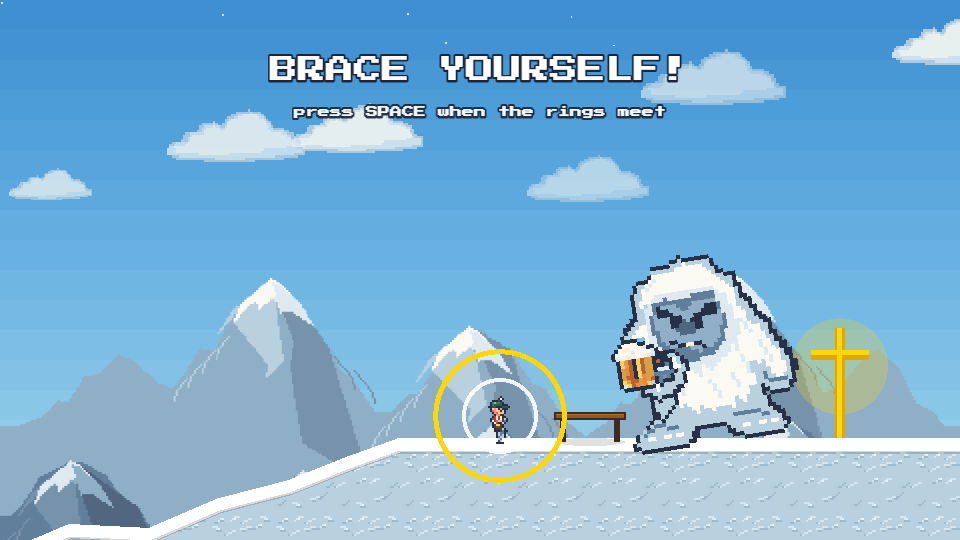
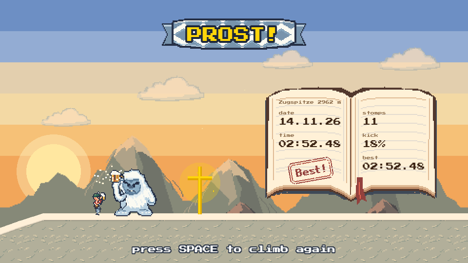

# zugspitze pogo

a yeti kicked you off the top of germany. he also took your beer.
grab your pogo stick and bounce back up the zugspitze to get it back.



- your spring gets weaker every bounce, stomp yetis, foxes and angry tourists to recharge it
- getting knocked down fills your **grit**, when it's full you launch a mega bounce
- dodge giant snowballs, slip on ice, bonk into rock walls
- you can't lose. you can only take ages.



## controls

| key | what it does |
| --- | --- |
| ← → / A D | tilt |
| hold SPACE / W | charge a big bounce |
| E | mega bounce (when grit is full) |
| P | pause |
| M | mute |

works on phones too.

## run it

```
npm install
npm run dev
```

`npm run build && npm run zip` makes the zip for itch.io.



made for a hackclub haven hackathon with the theme *bouncing back*. no yetis were harmed. one beer was.
